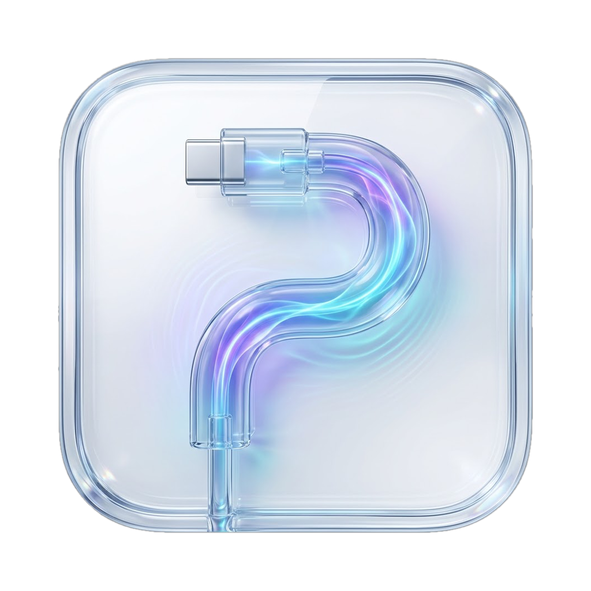

<p align="center"></p>

<h1 align="center">DFU Pulse</h1>

<p align="center">
Revive or restore a Mac, iPhone or iPad in DFU mode, from your Mac.<br>
Free, open source, native.
</p>

<p align="center">
<a href="https://github.com/BartoX360/DFU-Pulse/releases/latest"><b>Download the latest version</b></a>
</p>

*Une app libre et gratuite pour raviver ou restaurer un Mac, un iPhone ou un iPad en mode DFU depuis un Mac. L'interface est en français et en anglais.*

## Why

When a Mac no longer starts, or its firmware is broken, the fix is to connect it to another Mac in DFU mode and revive or restore it. Apple Configurator can do it, but finding the right port, the right key sequence and the right restore image is tedious. DFU Pulse puts all of it in one place.

## Features

- **Flash.** Detects a Mac, iPhone or iPad connected in DFU mode. A Mac can be **revived** (firmware and recoveryOS updated, data kept) or **restored** (erased, with the macOS version you pick). An iPhone or iPad is restored with an iOS or iPadOS version Apple still signs.
- **Automatic DFU entry.** One click puts the other Mac into DFU over USB-C, without touching its keyboard (Apple silicon to Apple silicon, through both DFU ports).
- **No password every time.** An optional helper, switched on once, lets the automatic entry run without asking for an administrator password.
- **Library.** Every macOS version Apple still signs, as one universal image per version, with the list of Macs it supports. Signed iOS and iPadOS images, model by model. Downloads resume after an interruption, are checked against their SHA-256 checksum, and stay on your Mac for the next time.
- **Port guide.** Which USB-C port is the DFU port on each Mac, the key sequence to enter DFU by hand, and the button sequence for each iPhone and iPad.
- **Safety checks.** Asks before erasing anything, and refuses to start a restore when the disk is too full to unpack the image.

## Requirements

- A Mac with Apple silicon, running macOS 26 or later.
- [Apple Configurator](https://apps.apple.com/app/apple-configurator/id1037126344), free on the Mac App Store. DFU Pulse drives its `cfgutil` tool for the revive and restore themselves.
- A cable that carries data: USB-C for a Mac, USB-C or Lightning for an iPhone or iPad. Thunderbolt 3 cables are not supported for a Mac.
- For a macOS restore, about twice the size of the image in free space (around 55 GB today): Apple Configurator unpacks the image before installing it.

## Install

1. Download `DFU-Pulse-x.y.z.dmg` from the [latest release](https://github.com/BartoX360/DFU-Pulse/releases/latest).
2. Open it and drag **DFU Pulse** to **Applications**.

The app is signed with a Developer ID and notarized by Apple: it opens like any other app.

On first launch, a short welcome walks you through installing Apple Configurator and, if you want it, enabling the helper. You can open it again from **Help → Welcome to DFU Pulse**.

## How to use it

### Revive or restore a Mac

1. In **Port guide**, find the DFU port of the Mac to flash and connect it to your Mac with a USB-C cable.
2. In **Flash**, click **Enter DFU automatically**, or follow the key sequence from the guide.
3. The Mac shows up in **Flash**. Try **Revive** first: it keeps the data. If that is not enough, choose **Restore**, pick a macOS version, download it if needed, and confirm.

### Restore an iPhone or iPad

1. Connect it to your Mac with a data cable.
2. Put it into DFU mode with its buttons: **Port guide → iPhone & iPad** shows the sequence for each model. In DFU mode the screen stays black.
3. In **Flash**, pick an iOS or iPadOS version, download it if needed, and confirm. Restoring erases the device; if Activation Lock is on, its Apple Account password is needed afterwards.

## Troubleshooting

- **The Mac does not show up.** Check that the cable carries data and is plugged into the DFU port, then enter DFU again. On the Mac running DFU Pulse, click **Allow** if macOS asks about the accessory.
- **"Not enough free space".** Apple Configurator unpacks the whole image on your Mac's internal disk before installing it. Free up the amount shown; moving the IPSW folder to an external disk does not change this.
- **"Failed to unzip the restore bundle".** Almost always a lack of free space. Otherwise, use **Verify** on the file in **Library**.
- **The Apple logo appears on the iPhone or iPad.** A button was held too long: start the sequence again.

## Privacy and security

- Restore images are downloaded **only from Apple's servers**; any other host is refused, whatever the catalog says. The list of versions comes from [ipsw.me](https://ipsw.me), with Apple's own feed as a fallback.
- DFU Pulse collects nothing and has no account.
- The helper is a small daemon inside the app, registered with `SMAppService` and switched on once in **System Settings → General → Login Items & Extensions**. launchd starts it only when needed. It accepts connections only from DFU Pulse signed by the same developer, checks the signature of `macvdmtool` before running it, and does nothing but put a Mac into DFU. Switch it off from **Settings** or System Settings at any time.
- Images are stored in `~/Library/Application Support/DFU Pulse/IPSW`, or the folder you choose in **Settings**.

## Build from source

```sh
brew install xcodegen
xcodegen generate
open DFUPulse.xcodeproj
```

The project is signed with the maintainer's team. To build your own copy, set `DEVELOPMENT_TEAM` and the team ID in `Shared/HelperProtocol.swift` to yours, since the app and its helper check each other's signature.

Releases are automatic: every new version number pushed to `main` is tested, signed, notarized and published by GitHub Actions through `scripts/package.sh --publish`.

## Credits

- [macvdmtool](https://github.com/AsahiLinux/macvdmtool) by the Asahi Linux contributors (Apache-2.0), bundled in `Vendor/`, sends the USB-C command that puts a Mac into DFU.
- [ipsw.me](https://ipsw.me) for the firmware catalog.

## License

[GPL-3.0](LICENSE). DFU Pulse is free software: any distributed derivative must stay free too. `Vendor/macvdmtool` keeps its Apache-2.0 license.

DFU Pulse is not affiliated with Apple. Apple, Mac, iPhone, iPad and Apple Configurator are trademarks of Apple Inc. Restoring erases the device: use it at your own risk.
