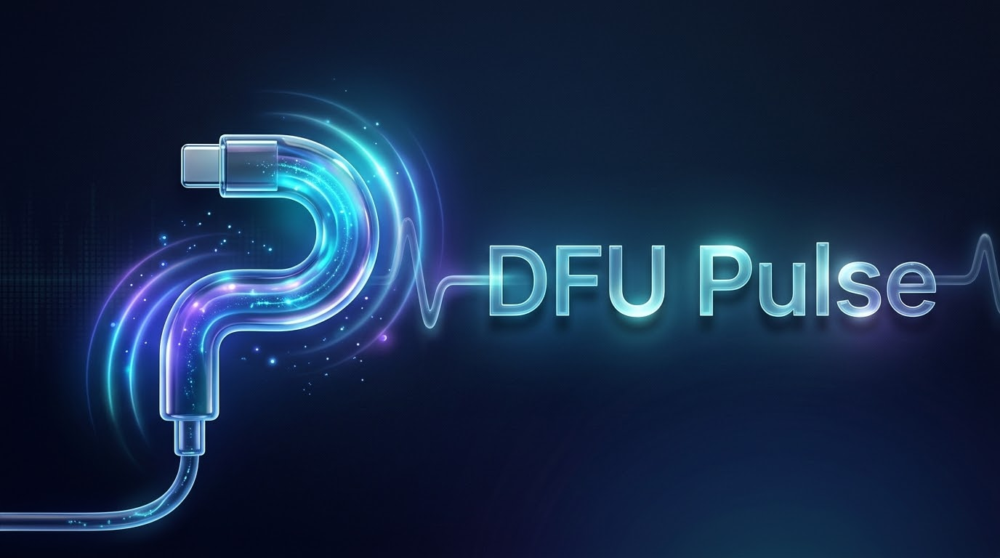

# DFU Pulse

A free, open-source macOS app to revive or restore a Mac in DFU mode, from another Mac.

*Une app libre et gratuite pour raviver ou restaurer un Mac en mode DFU depuis un autre Mac. L'interface est en français et en anglais.*

## What it does

- **Flash**: detects a Mac connected in DFU mode, then revives it (keeps data) or restores it (erases it) with the macOS version you pick.
- **Automatic DFU entry**: one click puts the other Mac into DFU over USB-C, without touching its keyboard (Apple silicon to Apple silicon, through both DFU ports).
- **Library**: downloads Apple's restore images (IPSW), checks their checksum, and keeps them on your Mac. Sort, verify, import, or trash them.
- **Port guide**: shows which USB-C port is the DFU port on each Mac, and the key sequence to enter DFU by hand.
- **Liquid Glass** interface, native SwiftUI.

## Requirements

- macOS 26 or later, on Apple silicon.
- [Apple Configurator](https://apps.apple.com/app/apple-configurator/id1037126344) (free). DFU Pulse drives its `cfgutil` tool for the actual revive and restore.
- A USB-C cable that carries data and charging. Thunderbolt 3 cables are not supported.
- About 60 GB of free space for a restore.

## Install

1. Download the latest `DFU-Pulse-x.y.z.dmg` from [Releases](https://github.com/BartoX360/DFU-Pulse/releases) and drag **DFU Pulse** to Applications.
2. Open it once. macOS blocks it because the app is not notarized by Apple (that requires a paid developer account).
3. Open **System Settings → Privacy & Security**, scroll down, and click **Open Anyway** next to DFU Pulse.

Or, in Terminal:

```sh
xattr -dr com.apple.quarantine "/Applications/DFU Pulse.app"
```

## Where things come from

- Firmware list: [ipsw.me](https://ipsw.me) for the full history and SHA-256 checksums, falling back to Apple's own feed. Files are only ever downloaded from Apple's servers: any other host is refused.
- IPSW files are stored in `~/Library/Application Support/DFU Pulse/IPSW` (configurable). Interrupted downloads resume.
- Automatic DFU entry uses [macvdmtool](https://github.com/AsahiLinux/macvdmtool) by the Asahi Linux contributors (Apache-2.0), bundled in `Vendor/`. It needs root, so macOS asks for an administrator password each time.

## Build

```sh
brew install xcodegen
xcodegen generate
open DFUPulse.xcodeproj
```

`scripts/package.sh` builds a DMG. Pushing a `v*` tag publishes a release through GitHub Actions.

## License

[GPL-3.0](LICENSE). DFU Pulse is free software: any distributed derivative must stay free too. `Vendor/macvdmtool` keeps its Apache-2.0 license.

DFU Pulse is not affiliated with Apple. Restoring erases a Mac: use it at your own risk.
